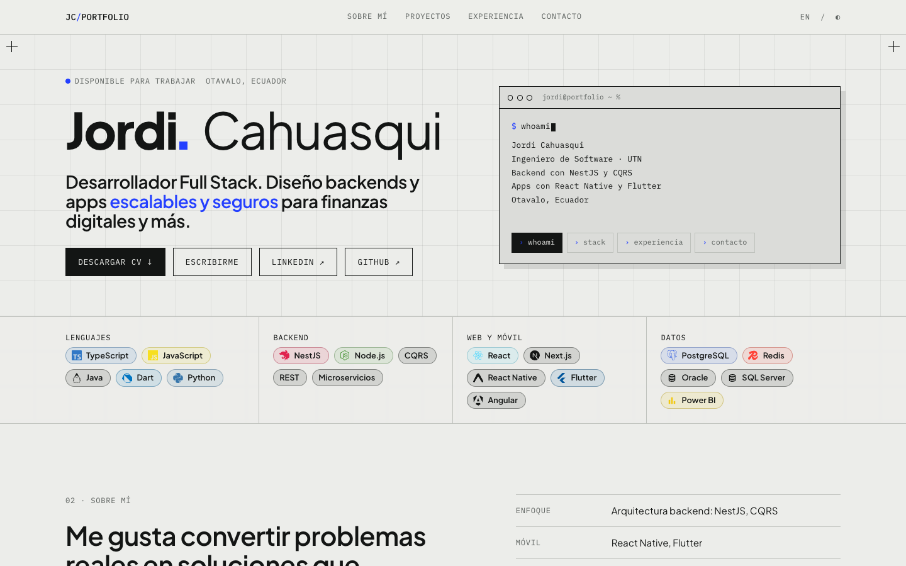
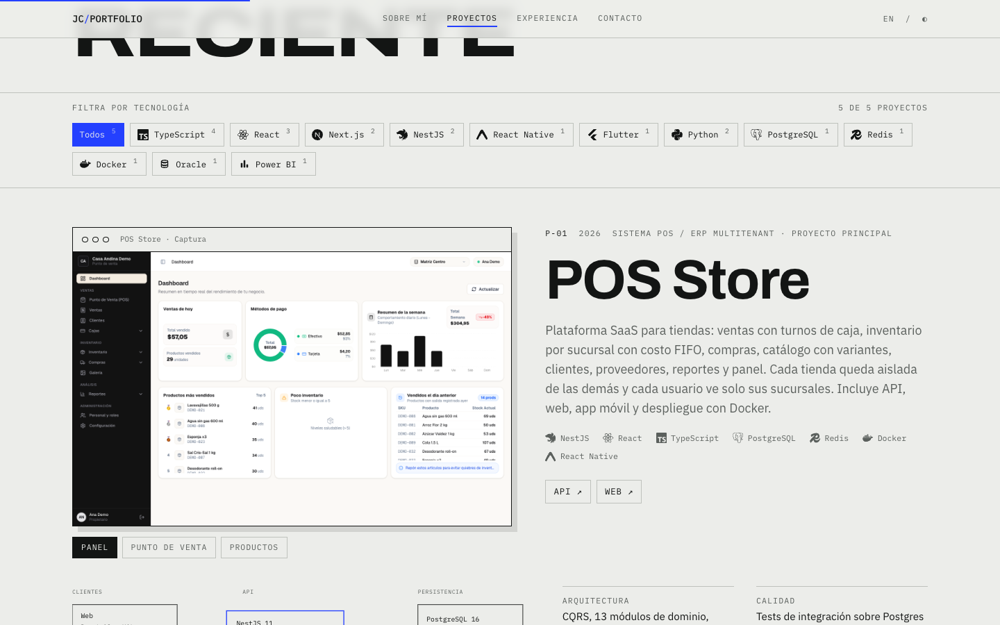
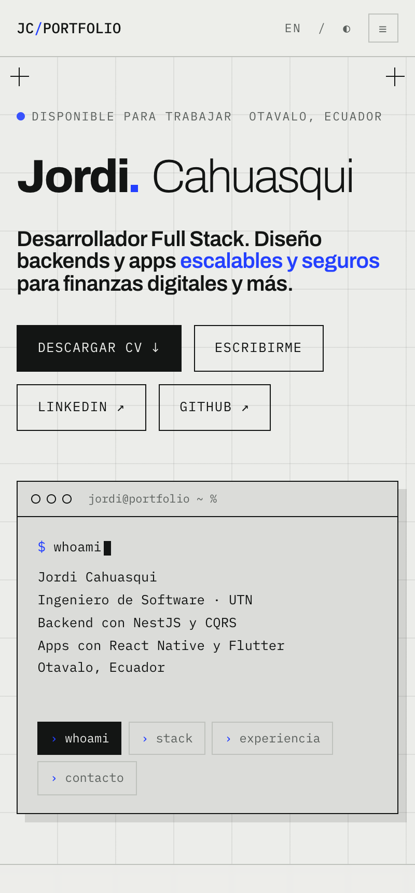

# Portafolio de Jordi Cahuasqui

Portafolio personal de un ingeniero de software: proyectos con capturas reales, experiencia, stack y contacto.
Bilingüe (ES/EN), con modo claro/oscuro y pensado para que un reclutador entienda el perfil en pocos segundos.



## Qué incluye

- **Héroe con terminal interactiva** (`whoami`, `stack`, `experiencia`, `contacto`) y bloque de tecnologías con iconos.
- **Proyectos filtrables por tecnología**: badges con icono y contador; al activar uno (o varios) se muestran solo los proyectos que lo usan.
- **Galería por proyecto**: marco de navegador con pestañas y visor ampliado. Si un proyecto no tiene captura, usa una lámina esquemática.
- **Diagrama de arquitectura** dibujado con SVG para el proyecto principal (POS Store).
- **Experiencia y reconocimientos** en formato de tabla de especificaciones.
- **Selector de idioma ES/EN**, tema claro/oscuro, barra de progreso, menú móvil y sección activa en el menú.
- **Accesible y rápido**: HTML estático, foco visible, respeto a `prefers-reduced-motion`, sin dependencias de UI en el cliente salvo GSAP.

| Proyectos y filtros | Móvil |
| --- | --- |
|  |  |

## Stack

[Astro](https://astro.build) · [Tailwind CSS 4](https://tailwindcss.com) · [GSAP](https://gsap.com) · TypeScript ·
[simple-icons](https://simpleicons.org) para los iconos de tecnologías · pnpm.

Diseño: concepto de "plano técnico" (hoja de dibujo, cuadrícula, bloque de título), tipografías Archivo, IBM Plex Sans e IBM Plex Mono.

## Empezar

Requisitos: Node 20+ y [pnpm](https://pnpm.io).

```bash
pnpm install
pnpm dev        # http://localhost:4321
pnpm build      # genera dist/
pnpm preview    # sirve dist/ en local
```

## Despliegue

Es un sitio estático. En [Vercel](https://vercel.com) basta con importar el repositorio: detecta Astro y no necesita configuración.
También sirve en Netlify, Cloudflare Pages o GitHub Pages (`pnpm build` y publicar `dist/`).

## Estructura

```
src/
  pages/index.astro        Ensambla la página: lista las secciones en orden
  layouts/Base.astro       <head>, fuentes, script de idioma/tema y scripts globales
  components/
    Header, Hero, About, Projects, Experience, Contact, Lightbox
    Terminal, Capabilities           (partes del héroe)
    ProjectFilters, ProjectCard,
    MediaFrame, ArchDiagram          (partes de Proyectos)
    _TemplateSection.astro           Plantilla para secciones nuevas
  data/
    content.ts   TODOS los textos y datos (proyectos, experiencia, perfil, filtros)
    ui.ts        Textos de interfaz, bloque de tecnologías y terminal del héroe
    plates.ts    Láminas esquemáticas de proyectos sin captura
  lib/
    nav.ts       Secciones del menú (orden y numeración)
    icons.ts     Iconos de tecnologías · media.ts  Capturas · i18n.ts  Idiomas
  scripts/       Lógica del navegador, un archivo por función
    prefs, nav, terminal, gallery, filters, motion  →  main.ts los inicia
  styles/global.css   Tokens de color, tipografía y estilos
public/
  projects/      Capturas: <id-del-proyecto>-<nombre>.png
  cv-es.pdf, cv-en.pdf
docs/            Imágenes de este README
```

## Cómo agregar una sección nueva

Ejemplo: una sección "Certificaciones".

**1. Escribe los textos** en `src/data/content.ts`, dentro de `t.es` y de `t.en`:

```ts
// en t.es
certifications: 'Certificaciones',
certList: [{ name: 'Nombre del curso', where: 'Plataforma', year: '2026' }],
// en t.en
certifications: 'Certifications',
certList: [{ name: 'Course name', where: 'Platform', year: '2026' }],
```

**2. Crea el componente.** Copia `src/components/_TemplateSection.astro` como
`src/components/Certifications.astro`, cambia `ID` por `'certifications'` y pon tu contenido:

```astro
---
import { langs } from '../lib/i18n';
import { t } from '../data/content';
import { sectionNumber } from '../lib/nav';
const ID = 'certifications' as const;
---
{langs.map((l) => (
  <section data-l={l} id={l === 'es' ? ID : undefined} class="wrap py-20 md:py-28" data-reveal>
    <h2 class="label pb-4">{sectionNumber(ID)} · {t[l][ID]}</h2>
    <ul>
      {t[l].certList.map((c) => <li>{c.name} · {c.where} · {c.year}</li>)}
    </ul>
  </section>
))}
```

**3. Regístrala en el menú** (`src/lib/nav.ts`), en la posición donde quieras que aparezca:

```ts
export const nav = [
  { id: 'about', key: 'about' },
  { id: 'work', key: 'work' },
  { id: 'exp', key: 'exp' },
  { id: 'certifications', key: 'certifications' }, // <- nueva
  { id: 'contact', key: 'contact' },
] as const;
```

**4. Colócala en la página** (`src/pages/index.astro`), en el mismo orden:

```astro
import Certifications from '../components/Certifications.astro';
...
<Experience />
<Certifications />
```

Con eso aparece en el menú (escritorio y móvil), con número automático, resaltado de sección activa,
animación de entrada (`data-reveal`) y cambio de idioma. No hace falta tocar scripts ni CSS.

Notas: `data-l={l}` muestra solo el idioma activo; el `id` va solo en la versión `es` para que no se repita.

## Otras tareas frecuentes

- **Añadir un proyecto:** agrega un objeto en `projects` de `t.es` y de `t.en` (`content.ts`) con un `id` único
  y su lista `tech`. Las tecnologías deben existir en `techs` (al final de `content.ts`) para salir como filtro.
- **Añadir capturas:** guarda `public/projects/<id>-<nombre>.png` (por ejemplo `utn-home.png`). Aparecen solas;
  con varias salen pestañas. Nombres con etiqueta propia: `dashboard`, `pos`, `products` (ver `lib/media.ts`).
- **Añadir un filtro de tecnología:** una línea en `techs` de `content.ts`. El icono usa la clave de
  [simple-icons](https://simpleicons.org) sin el prefijo `si` (p. ej. `Postgresql`); `''` usa un icono de base de datos.
- **Cambiar el CV:** reemplaza `public/cv-es.pdf` y `public/cv-en.pdf`.
- **Colores y tipografía:** tokens al inicio de `src/styles/global.css`.

## Licencia

MIT para el código. El contenido personal (textos, CV, imágenes de proyectos y certificados) es de Jordi Cahuasqui y no está cubierto por la licencia.
